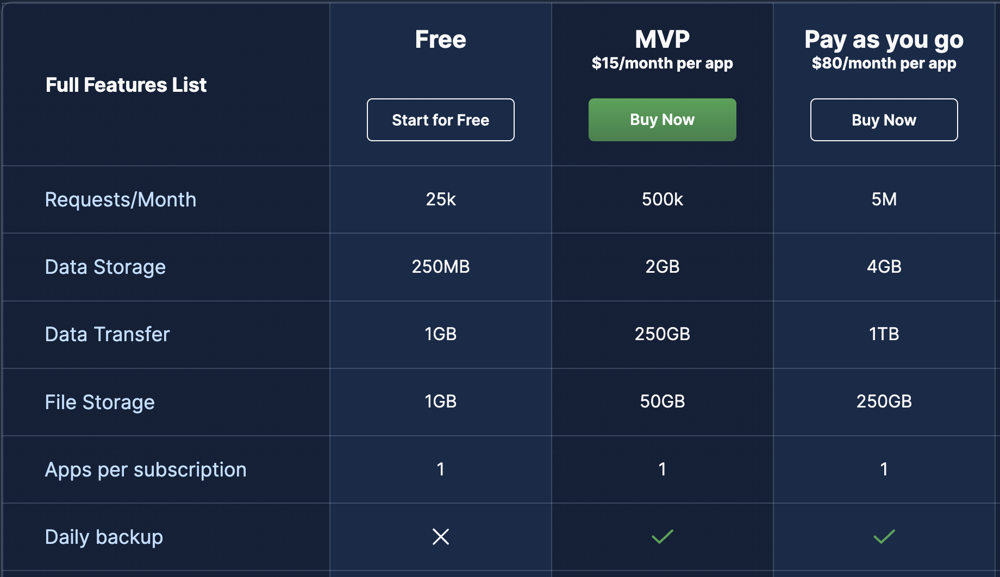
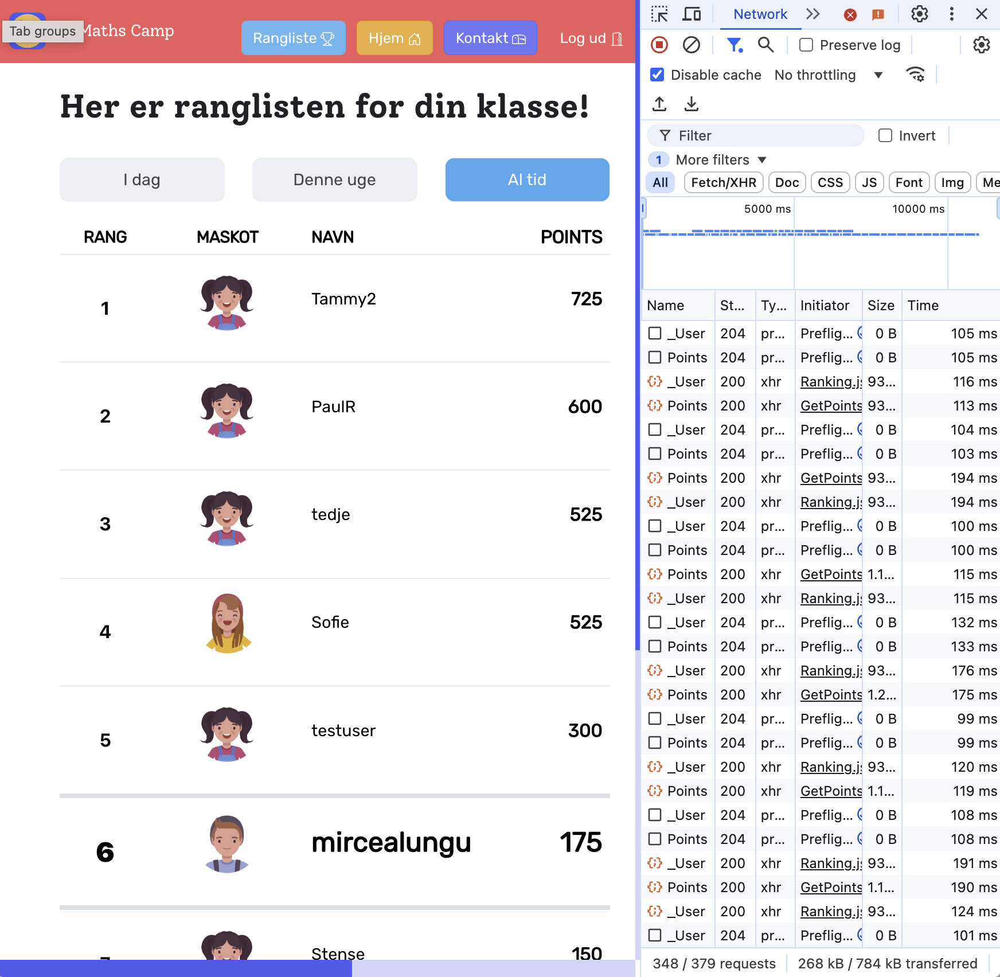

# Efficient Communication With the Backend

Your app talks to its backend over the network, and every conversation costs something: time for the user, and requests, bandwidth and money for you. This note is about having fewer, smaller conversations, and about how an app hears that something changed. None of it is specific to Parse; the [appendix](#appendix-in-parse) shows the Parse spelling.

## Every request costs time, and on a hosted backend it also costs money

A backend-as-a-service like Back4App is a computer someone else runs for you, and they charge for it. The free tier you use limits:

- the number of requests,
- the data transferred,
- the data stored.



So the way your app talks to the backend is a design decision with two prices. Too many requests make the app slower *and* use up the quota faster. Usually fixing one fixes the other.

Here is the Network tab of a student app, MathsCamp, loading one screen:



**Discussion:** Why might we want to improve this? To save money, or to have a faster app? Which of the two would a user notice?

## One query, then one more for each result: the N+1 problem wastes the most requests

The most common way to waste requests: you ask for a list of N things, and then, for each of them, you ask for one more thing. One request becomes N+1. With ten lists it is eleven requests; with a hundred, it is a hundred and one, each one a round trip the user waits for.

**You have written one already, and you have already fixed one.** In week 5, [Loading the page, the simple way](Relationships-Between-Object-Classes.md#loading-the-page-the-simple-way) queried the lists, and then ran one more query *inside each list's block* for its to-dos. In week 6, [the sharing queries](Many-to-Many-Sharing-a-List.md#armins-lists-and-adas-members-are-ordinary-queries) asked for the memberships *together with* their lists and the lists' owners, so that "shared by ada" did not cost one extra request per list. That was the fix; this section gives the problem its name.

## Related objects can come back in the same request, as in a SQL join

The fix is always the same: tell the backend, in the first request, what else you are going to need. A query for to-dos that will be shown with their list's name asks for the to-dos *including* their lists. The backend follows the references on its side, where it is fast, and sends everything back in one answer.

In SQL this is a `JOIN`. Every backend has a way to say it; in Parse it is `include` (see the appendix).

## Fields the screen does not show are bandwidth wasted

The opposite waste: one request, but far more data than the screen needs. A list of to-do titles does not need each to-do's long description, its attached photos, or its history. Ask for the fields you will show, and the answer gets smaller and faster.

In SQL this is the difference between `SELECT *` and `SELECT title, done`. In Parse it is `select` and `exclude`.

## Shared data changes while the user looks at it

For most screens, nobody else changes the data while it is shown: you are editing your own list. But when a screen shows data that *other people* change (the shared grocery list your flatmate is ticking off in the shop, the household's meal plan, a chat), the screen goes stale. There are two ways to keep it fresh.

### Polling asks again every few seconds, and is usually enough

The simple way: set a timer, and when it fires, load the data again and show it. Nothing changes on the server; it is just the same query, repeated.

Every poll is a request, so poll only on screens that show shared data, only while they are open, and every few seconds rather than every few milliseconds. Cheaper still: reload when the user comes back to the app, which needs no timer at all.

In React, a timer started in an effect must be stopped when the component goes away, or every visit to the page starts one more timer that never stops:

```js
useEffect(() => {
  const interval = setInterval(() => {
    // load the data again
  }, 10000);

  return () => clearInterval(interval); // the page is closed: stop asking
}, []);
```

Because that cleanup is so easy to forget, next week [Custom Hooks](../React/Custom-Hooks.md#a-polling-timer-belongs-in-a-hook-because-its-cleanup-is-easy-to-forget) writes it once, as `useInterval`.

### Push lets the server announce a change, and is worth it only when seconds matter

The other way round: the app keeps a connection to the server open and **subscribes** to a query, and the server sends a message the moment something matching it is created, changed or deleted. Nothing is asked twice; the update arrives as soon as it happens.

It is the [observer pattern](https://refactoring.guru/design-patterns/observer) across the network, and most backends offer it under their own name: Parse calls it *LiveQuery*, Firebase has `onSnapshot`, Supabase calls it *Realtime*. Underneath it is usually a **WebSocket**, a connection that stays open so that either side can send at any time, unlike an ordinary request, which the client always starts.

Push is the right tool when a few seconds of delay is visible: a chat, a multiplayer game, a cursor in a shared document. It is also more to set up, more to clean up, and more to debug. For a grocery list, nobody notices whether an item appears now or ten seconds from now. **Start with polling; move to push when a user can tell the difference.**

## Exam Questions

### 1. What is the N+1 problem? Where did you write one, and how did you fix it?

### 2. What is wrong with this code, and which single line fixes it?
```js
const query = new Parse.Query("TodoItem");
const todos = await query.find();

for (let todo of todos) {
  const list = todo.get("list");
  await list.fetch();
  console.log(list.get("name"));
}
```

### 3. What is the difference between polling and push? Why is polling usually enough for a shared grocery list, and when is it not?

### 4. Why ask for only some fields of an object, when one request brings the whole object anyway?

### 5. A page polls every ten seconds with `setInterval` in a `useEffect`, without a cleanup function. What happens after the user has opened and left that page five times?

## Appendix: in Parse

**Related objects: `include`.** A pointer comes back as just an id. `include` asks Parse to send the object it points at too:

```js
const query = new Parse.Query("TodoItem");
query.equalTo("done", false);
query.include("list");            // the list each to-do points at, in the same answer
const todos = await query.find();

todos[0].get("list").get("name"); // no second request
```

Pointers of pointers work with a dot: `include("list.owner")`.

**Only some fields: `select` and `exclude`.**

```js
query.select("text", "done");     // only these fields
query.exclude("notes", "photo");  // everything except these
```

Use `select` when you need a few fields, `exclude` when you need all but a few large ones.

**Push: LiveQuery.** It has to be switched on for each class in the server settings, and then:

```js
const subscription = await new Parse.Query("TodoItem")
  .equalTo("list", list)
  .subscribe();

subscription.on("create", (todo) => { /* add it to the screen */ });
subscription.on("update", (todo) => { /* replace it */ });
subscription.on("delete", (todo) => { /* remove it */ });

// and when the page closes:
subscription.unsubscribe();
```

See [Live Queries](https://docs.parseplatform.org/js/guide/#live-queries) in the Parse guide.
