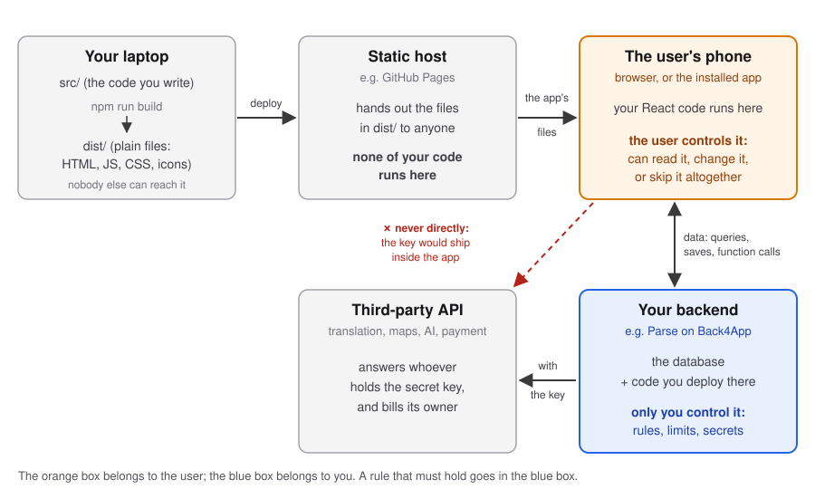
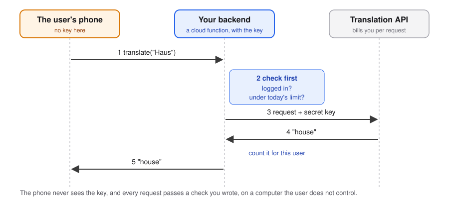

# Running Code Server-Side

[When Users Break Your App](../Tooling/When-Users-Break-Your-App.md) ended with limits that only hold on the server. Before writing any, one picture of where each part of your app runs, because which code goes where follows from it.



## Building turns your code into plain files, and deploying copies them somewhere public

What you write is not what you ship. The build takes your components, your imports and your libraries, and produces a folder of plain files that any browser understands: one HTML page, a few bundled JavaScript and CSS files, and whatever images and icons you put next to them. Deploying copies that folder to a computer that is always on and that anyone can reach.

You have done this since week 6 ([Publishing Your App on GitHub Pages](../Tooling/Publishing-on-GitHub-Pages.md)). The tools are a detail: a different bundler or a different host changes the commands, not the picture.

## The static host runs none of your code, so it can keep none of your secrets

GitHub Pages, and every host like it, does one thing: when a browser asks for a file, it sends the file. It does not run your JavaScript; it does not know what your app does. That is why it can be free, and why anything that can serve files can host your app.

It also means there is nowhere on it to keep a secret. Everything in the folder you deployed is readable by anyone who asks for it.

## The phone runs your code, and the user owns the phone

Your React code runs on the user's device. That is what makes the app fast and pleasant: a click changes the screen without asking anyone.

It also means the code is the user's to do with as they like. They can open the developer tools and read it, including the Parse keys in it. They can change a variable and click again. They can skip your app entirely and send requests to your backend from a script, with values your form would never have let through. A check written in a component is a check *the user agreed to run*.

## A rule belongs on the server if it must hold no matter what the user does

That gives the principle for deciding where a piece of code goes:

> **The client belongs to the user; the server belongs to you. Anything that must hold no matter what the user does runs on the server. Anything that only makes the experience better can run on the client.**

On the server, then:

- **rules and permissions**: who may read or change what (the ACLs you set since week 5 are such rules: the server enforces them);
- **limits**: how long a name, how many items, how many requests per day;
- **secrets**: any key that costs money or grants access, such as the key to a translation or AI service;
- **other users' data**: statistics over everyone, which no single user may download;
- **things that must happen even if the app is closed**: a log entry when a task is done, a cleanup when a list is deleted.

On the client: instant feedback, a disabled button, a character counter, a friendly message. These should **repeat** what the server enforces, so the user hears "too long" before sending rather than after; they never replace it.

[When Users Break Your App](../Tooling/When-Users-Break-Your-App.md) showed what happens when they are not. The rest of this note shows how each is written.

## A backend runs your code next to the data, in triggers and in functions

A backend like Parse lets you deploy small pieces of JavaScript that run **on the server**, where the user cannot reach them. They come in two kinds:

- **triggers**, which run by themselves before or after something is saved or deleted;
- **cloud functions**, which your app calls by name, like a function that happens to run on another computer.

## Essential complexity belongs to the problem; accidental complexity belongs to the tools

In *No Silver Bullet* (1986), Fred Brooks split the complexity of software in two. **Essential** complexity is in the problem itself: a list holds at most 500 items; a translation costs money. **Accidental** complexity comes from the tools we solve it with: what the trigger is called, where the object is found in the request, which option skips the permission check.

Every example below is a few lines of essential rule wrapped in Parse's accidental ones. The rule would survive a move to Firebase or to your own server; the wrapping would not. When you read one, find the rule first. The Parse mechanics are collected in the [appendix](#appendix-the-parse-mechanics).

## The first job of server code is to say no

The most common server code is a check before a write. In Parse it is a `beforeSave` trigger: it runs before every save of an object of that class, from any client, and if it throws, the save does not happen.

### A check that only the client makes is a suggestion

```js
Parse.Cloud.beforeSave("TodoItem", (request) => {
  const text = request.object.get("text");

  if (!text || text.trim().length === 0) {
    throw new Parse.Error(Parse.Error.VALIDATION_ERROR, "A to-do needs a text");
  }
  if (text.length > 200) {
    throw new Parse.Error(Parse.Error.VALIDATION_ERROR, "A to-do can be at most 200 characters");
  }
});
```

Your form probably already refuses an empty to-do. Keep that: it tells the user before they press the button. But the form only runs if the user uses your form. The trigger runs for every save, whoever sends it.

### A per-user limit counts before it lets a save through

The first question from the previous note: how do you stop one user from putting a million to-dos in a list? Count what is already there:

```js
Parse.Cloud.beforeSave("TodoItem", async (request) => {
  if (request.original) return; // an edit, not a new to-do: nothing to count

  const count = await new Parse.Query("TodoItem")
    .equalTo("list", request.object.get("list"))
    .count({ useMasterKey: true });

  if (count >= 500) {
    throw new Parse.Error(Parse.Error.VALIDATION_ERROR, "A list can hold at most 500 to-dos");
  }
});
```

Choose the number the way [When Users Break Your App](../Tooling/When-Users-Break-Your-App.md#choose-the-limit-from-what-the-data-is-for) chose it: from what the data is for. A shopping list with 500 items is no longer a shopping list.

### A limit on sign-ups counts by network address

The second question: a million accounts. A new user is a save too, of the special class `_User`, and the request knows the IP address it came from:

```js
Parse.Cloud.beforeSave(Parse.User, async (request) => {
  if (request.original) return; // only sign-ups, not profile changes

  request.object.set("signUpIp", request.ip);

  const oneHourAgo = new Date(Date.now() - 60 * 60 * 1000);
  const recent = await new Parse.Query(Parse.User)
    .equalTo("signUpIp", request.ip)
    .greaterThan("createdAt", oneHourAgo)
    .count({ useMasterKey: true });

  if (recent >= 5) {
    throw new Parse.Error(Parse.Error.VALIDATION_ERROR, "Too many new accounts from this network. Try again later.");
  }
});
```

Five an hour is plenty for a family signing up together, and nothing for a script. A whole class on the ITU network shares one address, though: think about who your limit hits besides the attacker.

### A toast tells the user what the server refused, without stopping them

A refused save reaches your app as an error from `save()`. What the user sees is up to you, and `alert()` is the worst choice: it stops everything, looks like the browser's and not your app's, and must be clicked away.

The usual pattern is a **toast**: a short message that slides in at the edge of the screen, says what happened ("A list can hold at most 500 to-dos"), and disappears by itself after a few seconds, without blocking anything. Use it for messages the user should notice but need not act on. If they must decide something, use a dialog; if the problem belongs to one field, put the message next to the field. In each case, keep what the user typed, so a refused save does not also cost them their input.

## A secret key stays on the server, and the app asks the server to use it

A translation service, a maps API, an AI model: each gives you a **secret key**, and bills you for every request made with it. Put the key in your app and it ships to every phone (the static host [cannot keep secrets](#the-static-host-runs-none-of-your-code-so-it-can-keep-none-of-your-secrets)); anyone can copy it and spend your money.

So the app does not call the service. It calls a cloud function on your server, which checks the request, calls the service with the key, and passes the answer back:



From the app, a cloud function is called by name:

```js
const translation = await Parse.Cloud.run("translate", { word: "Haus" });
```

On the server, step 2 of the diagram is the part you are paid for; steps 3 and 4 are plumbing:

```js
Parse.Cloud.define("translate", async (request) => {
  if (!request.user) {
    throw new Parse.Error(Parse.Error.INVALID_SESSION_TOKEN, "Log in to translate");
  }

  // 2: under today's limit? Every translation was written down, so we can count them.
  const startOfToday = new Date();
  startOfToday.setHours(0, 0, 0, 0);
  const usedToday = await new Parse.Query("Translation")
    .equalTo("user", request.user)
    .greaterThan("createdAt", startOfToday)
    .count({ useMasterKey: true });
  if (usedToday >= 100) {
    throw new Parse.Error(Parse.Error.VALIDATION_ERROR, "That's 100 translations today. More tomorrow!");
  }

  // 3 and 4: the service, with the key that only the server knows
  const response = await fetch("https://translation.example.com/v1/translate", {
    method: "POST",
    headers: { Authorization: `Bearer ${process.env.TRANSLATION_API_KEY}` },
    body: JSON.stringify({ text: request.params.word, to: "en" }),
  });
  const { translation } = await response.json();

  // count it for this user
  const log = new Parse.Object("Translation");
  log.set("user", request.user);
  log.set("word", request.params.word);
  await log.save(null, { useMasterKey: true });

  return translation;
});
```

`translation.example.com` stands for whichever service you use; its documentation says what to send.

## Statistics over everyone's data are computed where the data is

Some answers need every user's data: the average time spent on a task, how many lists were created this week. The app cannot compute them, because a user may not download everyone else's to-dos, and should not have to. A cloud function can: it runs with full access, computes the number, and returns only the number.

```js
Parse.Cloud.define("weeklyStats", async () => {
  const oneWeekAgo = new Date(Date.now() - 7 * 24 * 60 * 60 * 1000);
  const query = new Parse.Query("TodoItem").greaterThan("createdAt", oneWeekAgo);

  const created = await query.count({ useMasterKey: true });
  const done = await query.equalTo("done", true).count({ useMasterKey: true });

  return { created, done };
});
```

If such a number is expensive and asked for often, compute it once a day and store it, instead of on every request.

## An `afterSave` trigger cannot refuse a save; it carries out its consequences

An `afterSave` trigger runs after a save has succeeded. It cannot refuse anything; it is for consequences. Here, every time a to-do is ticked off, the server writes a log entry, whichever client ticked it:

```js
Parse.Cloud.afterSave("TodoItem", async (request) => {
  const justDone =
    request.object.get("done") === true &&
    request.original?.get("done") === false;
  if (!justDone) return;

  const entry = new Parse.Object("CompletionLog");
  entry.set("list", request.object.get("list"));
  entry.set("doneBy", request.user);
  await entry.save(null, { useMasterKey: true });
});
```

**Exercise.** Mark the lines of this trigger that state the rule (the essential complexity), and the lines that are there because it is Parse (the accidental complexity). Then write the rule in one sentence, without any code. Is the sentence complete? (Hint: what does "just" in *just ticked off* need to be computed from?)

## A pointer has no integrity, so a delete does the cleanup by hand

A Parse pointer is not a checked foreign key (see [Relationships Between Object Classes](Relationships-Between-Object-Classes.md#a-pointer-is-a-foreign-key-that-nobody-checks)): delete a list, and its to-dos stay behind, pointing at nothing. Parse has no cascading deletes either. A `beforeDelete` trigger is where you put that rule back:

```js
Parse.Cloud.beforeDelete("List", async (request) => {
  const todos = await new Parse.Query("TodoItem")
    .equalTo("list", request.object)
    .find({ useMasterKey: true });
  await Parse.Object.destroyAll(todos, { useMasterKey: true });
});
```

The other policy is to refuse: `throw` if the list still has to-dos, and the delete does not happen. Either way the rule now lives on the server, where no client can skip it.

### A relational database cascades by itself, and code still has work to do before a delete

In the relational databases from your database course, this rule is not code: it is part of the schema. A foreign key declared `ON DELETE CASCADE` removes the to-dos with their list; `ON DELETE RESTRICT` refuses the delete. Parse makes you write by hand what SQL gives you in one clause.

But even with a relational database, some things have to happen before a delete, and the schema cannot do them:

- **things outside the database**: a list's uploaded photos live in file storage, which no foreign key reaches;
- **undo**: many apps never really delete; they mark the row as deleted (a *soft delete*) and hide it, so that "Undo" and "Restore from trash" are possible;
- **history**: an archive or an audit log of what was deleted, by whom, and when;
- **rules no key can express**: you cannot delete the last admin of a household; a list shared with others warns them first.

## Exam Questions

### 1. When should code run on the server rather than on the client? State the principle, and give three kinds of code that follow from it.

### 2. Why can a static host like GitHub Pages be free, and why can it never keep a secret for your app?

### 3. Your form refuses empty to-dos. Why do you still need this trigger?
```js
Parse.Cloud.beforeSave("TodoItem", (request) => {
  const text = request.object.get("text");
  if (!text || text.trim().length === 0) {
    throw new Parse.Error(Parse.Error.VALIDATION_ERROR, "A to-do needs a text");
  }
});
```

### 4. What is the difference between `beforeSave` and `afterSave`? Give one use of each.

### 5. How do you stop one user from creating a million to-dos? How do you stop one person from creating a million accounts?

### 6. Your app uses a paid translation service. Why can the app not call it directly, and what does the cloud function in between do besides hiding the key?

### 7. What are essential and accidental complexity? Point to one of each in the `beforeDelete` trigger above.

### 8. In a relational database, deleting a list can delete its to-dos without any code. Name two things that still need code before a delete.

## Appendix: the Parse mechanics

**Where the code goes.** On Back4App: **Dashboard → Cloud Code**, edit `cloud/main.js`, and press **Deploy** (see [Back4App's guide](https://www.back4app.com/docs/get-started/cloud-functions)). The code then lives in the dashboard, not in your repository, so nobody reviews it in a pull request. Keep a copy of `cloud/main.js` in your repository and paste from there, or deploy from the command line with Back4App's CLI.

**One trigger per class and event.** Parse keeps one `beforeSave` per class: registering a second replaces the first. In your project, the validation and the limit for `TodoItem` go in the same function.

**What the request carries:**

| | |
|---|---|
| `request.object` | the object being saved or deleted, with the new values |
| `request.original` | the object as it was before this save; `undefined` when it is new |
| `request.user` | the logged-in user who sent the request, if any |
| `request.params` | the parameters a cloud function was called with |
| `request.ip` | the address the request came from |

**`useMasterKey: true`** lets server code read and write past ACLs and class-level permissions. The counts above need it, because they must see objects the requesting user may not. It works only on the server; never put the master key in your app.

**Secrets** such as `TRANSLATION_API_KEY` go in the server's environment variables (on Back4App, in the app's server settings), and are read with `process.env`. They never appear in `main.js`, which you may want to keep in a public repository.

**Built-in rate limits.** Parse Server also has a `rateLimit` option that caps requests per IP address for a function or a class. It is configured on the server rather than written as a trigger; the hand-written count above shows what such an option does.

**Protect what you store about users.** `signUpIp` is personal data on a class that sign-up makes partly readable ([Sharing a List](Many-to-Many-Sharing-a-List.md#protected-fields-hide-every-column-except-the-username)). Add it to the protected fields, so only the server sees it.
