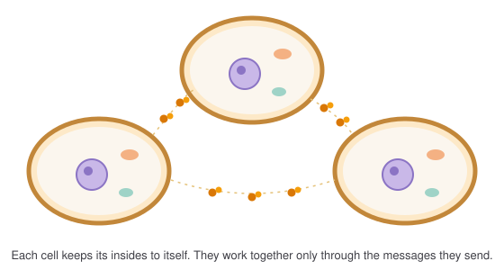

# Custom Hooks



Alan Kay studied molecular biology before he turned to computers, and he coined the term *object-oriented*. He imagined software built like a body: out of cells. Each cell keeps its insides behind a membrane, and cells work together only by sending each other messages. Nobody reaches into another cell.

A component, a service and a custom hook are such cells. A row that calls `onRemove` sends a message; a row holding `setTodos` is a hole in the membrane.

[The Three States of Remote Data](The-Three-States-of-Remote-Data.md) ended with a promise: every screen that fetches needs the same `useState` pair and the same `useEffect`, and "later in the course we come back and do something about this one." This is that note.

## A custom hook is the third way to pull out a part and give it a name

You have done this twice already. Each time, you found a part of a component that did its own job, moved it out, gave it a name, and hid a decision behind that name:

| what you pull out | where it goes | what it hides |
|---|---|---|
| repeated JSX | a component ([week 8](../Structure/Finding-the-Components.md)) | how a row is drawn |
| talking to the backend | a service ([week 8](../Structure/Pulling-Out-the-Service-Layer.md)) | that the data comes from Parse |
| state and effects | a custom hook (this note) | how loading, errors and stale answers work |

The principle is the same in all three, and older than React.

### Decomposition: cut the whole into parts you can name

Each part does one job and has a name in a word or two: `MyListRow`, `listService`, `useList`. The whole then reads as its names: `Home` is two headings, two kinds of row and a form.

### Encapsulation: each part hides a decision

`listService` hides that the data comes from Parse. `useList` hides how the page keeps track of loading, the result and the error. Nothing outside depends on what is hidden.

### Cut where a decision is likely to change

Parnas, 1972: put each decision that may change inside one part. When it changes (Parse for another backend, polling for push), only that part changes.

### The cut buys reading first, changing second, reuse last

- **Reading:** a part makes sense without the rest.
- **Changing:** one decision, one place.
- **Reuse:** a bonus. Most parts are worth it even when used once.

### Every part costs a name and a jump

Too few parts, and one component does everything. Too many, and following one click means opening five files.

### Three questions decide every cut

1. **Can you name it?** If not, it is not one thing yet.
2. **What does it hide?** If nothing, it is only indirection.
3. **Would a change of that decision stay inside it?** If not, the cut is in the wrong place.

Custom hooks are how React applies this to state. Another framework names the third row differently; the questions stay the same.

## Every page that loads something repeats the same lines

Here is `ListPage` from todo-26, once its query has moved into `loadList(listId)` in a service, as in the week 8 exercise:

```jsx
export default function ListPage() {
  const { listId } = useParams();

  const [list, setList] = useState(null);
  const [loading, setLoading] = useState(true);
  const [error, setError] = useState(null);

  useEffect(() => {
    async function load() {
      setLoading(true);
      setError(null);
      try {
        setList(await loadList(listId));
      } catch (err) {
        setError(err.message);
      }
      setLoading(false);
    }
    load();
  }, [listId]);

  if (loading) return <p>Loading…</p>;
  if (error) return <p>{error}</p>;
  return <ToDoList list={list} />;
}
```

The home page that loads your lists has the same three `useState` calls, the same `useEffect`, and the same `try`/`catch`. So does every page in your group project that shows something from Parse. Only two things change from one copy to the next: *which* service function is called, and *what* the page renders.

The service layer could not remove this duplication, because it is not about talking to Parse. It is about **React state**: something is loading, then it is there or it failed. Moving state out of a component needs a hook.

## A custom hook is a function whose name starts with `use`, that calls other hooks, and that follows the rules of hooks

There is no API to register it and nothing to import from React to make one. But because it calls hooks, the [rules of hooks](Hooks.md#the-rules-top-level-always-unconditionally) from week 1 apply to it, on both sides:

- **Inside it**, every hook is called at the top level, in the same order on every render: never inside an `if`, a loop or a nested function. An `if` around *other* code is fine; `useList` below has a `try`/`catch` inside its effect.
- **Its callers** call it only from a component or from another hook, again at the top level: never from an event handler or a plain function.

```jsx
// src/hooks/useList.js
import { useEffect, useState } from "react";
import { loadList } from "../services/listService.js";

export function useList(listId) {
  const [list, setList] = useState(null);
  const [loading, setLoading] = useState(true);
  const [error, setError] = useState(null);

  useEffect(() => {
    async function load() {
      setLoading(true);
      setError(null);
      try {
        setList(await loadList(listId));
      } catch (err) {
        setError(err.message);
      }
      setLoading(false);
    }
    load();
  }, [listId]);

  return { list, loading, error };
}
```

And the page shrinks to what it is actually about:

```jsx
export default function ListPage() {

  const { listId } = useParams();
  const { list, loading, error } = useList(listId);

  if (loading) return <p>Loading…</p>;
  if (error) return <p>{error}</p>;
  return <ToDoList list={list} />;
}
```

The `use` prefix is not decoration. It is how the rules-of-hooks linter knows that this function calls hooks, so it checks both sides. Name it `getList` and the linter goes quiet, but the rules still apply, and breaking them still breaks your component.

## A hook returns data, never JSX

A custom hook returns values (state, and functions that change it), never JSX. `useList` does not know whether the list ends up in a `<ul>`, a MUI `Card`, or a count in the navigation bar; `ListPage` decides. That keeps the hook usable by any screen, the same way a service is usable by any hook.

When a hook starts returning `<p>Loading…</p>`, it has turned into a component with an odd name. Turn it into a component.

## A polling timer belongs in a hook, because its cleanup is easy to forget

[Efficient Communication](../Backend/Efficient-Communication-with-the-Backend.md#polling-asks-again-every-few-seconds-and-is-usually-enough) shows how to reload data every few seconds with `setInterval`, and why the interval must be cleared when the component goes away. Forgetting that cleanup is exactly the kind of mistake a hook prevents. The first version is short:

```jsx
// src/hooks/useInterval.js
import { useEffect } from "react";

export function useInterval(callback, milliseconds) {
  useEffect(() => {
    const id = setInterval(callback, milliseconds);
    return () => clearInterval(id);
  }, [callback, milliseconds]);
}
```

```jsx
// the shopping list reloads every ten seconds while it is open
useInterval(reload, 10_000);
```

### A ref keeps the latest callback without restarting the timer

That version has a problem you only see in use. `reload` is defined inside the component, so it is a **new function on every render**. It is in the dependency array, so every render clears the timer and starts a new one. Type into a form on that page, and each keystroke restarts the ten seconds: the list never reloads while you type.

Take `callback` out of the dependencies, and the opposite happens: the timer keeps the `reload` from the first render forever, with the state of the first render in it (a *stale closure*).

What the hook needs is a place to keep **the latest callback, without restarting the timer when it changes**: a value that survives renders, and whose change does not cause one. That is exactly what a ref is ([The useRef Hook](The-useRef-Hook.md)):

```jsx
import { useEffect, useRef } from "react";

export function useInterval(callback, milliseconds) {
  const latestCallback = useRef(callback);

  // after every render, remember the newest callback; the timer is not touched
  useEffect(() => {
    latestCallback.current = callback;
  });

  // the timer starts once, and always calls whatever callback is newest
  useEffect(() => {
    const id = setInterval(() => latestCallback.current(), milliseconds);
    return () => clearInterval(id);
  }, [milliseconds]);
}
```

The component still writes `useInterval(reload, 10_000)`. All of this is inside the hook, which is the point: the tricky part has one home.

## A hook can wrap a browser event just as well as a fetch

Hooks are not only for remote data. Anything a component has to *subscribe to and clean up after* is a candidate: a timer, the window's width, whether the browser is online.

Once a project has a `src/hooks/` folder, the hook names read like a list of what the app does: `useList`, `useInterval`. Each one names a single behavior, which is the same test you apply to a component name.

## Exam Questions

### 1. What makes a function a custom hook? What changes if you rename `useList` to `getList`?

### 2. Why should a custom hook return data rather than JSX?

### 3. Write `useInterval(callback, milliseconds)`. What happens if you leave out the function that `useEffect` returns?

### 4. Give two reasons to extract a custom hook that only one component uses.

### 5. Why does `useInterval` keep the callback in a ref instead of putting it in the effect's dependency array?

## References

- [Reusing Logic with Custom Hooks](https://react.dev/learn/reusing-logic-with-custom-hooks), react.dev
- David L. Parnas, [On the Criteria To Be Used in Decomposing Systems into Modules](https://dl.acm.org/doi/10.1145/361598.361623), *Communications of the ACM*, 1972: the paper behind "hide each decision likely to change"
