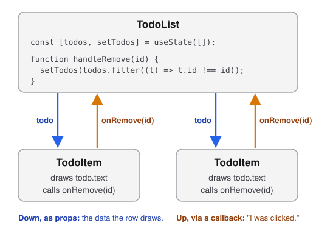
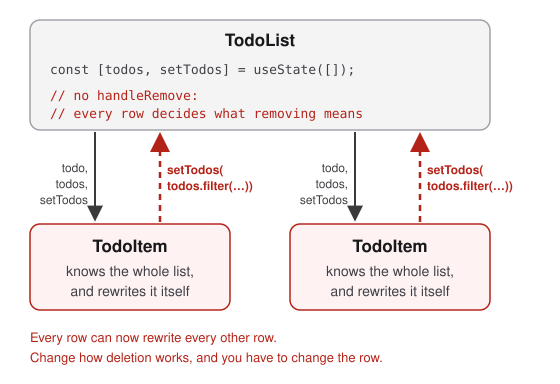
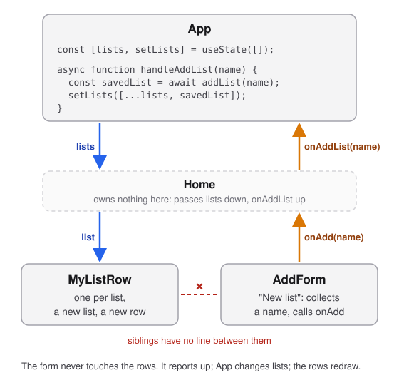

# Extracting Components and Where the State Goes

## A parent and its child talk in two directions, with two mechanisms

Components are arranged in a tree, and information has to travel along it. There are only two directions, and they use different mechanisms.

You have been writing both since week 2, without the names. The to-do list hands each row a `todo` and an `onRemove`; the row calls `onRemove` and knows nothing about what happens next. This note is that arrangement, named, and the shortcut that looks easier and is not.



### Data goes down as props, events come back up as callbacks

The parent hands each row what it needs to draw itself: its `todo`. Nothing comes back the same way. The row calls the function it was handed, `onRemove(id)`, and that is all it does: it is not deleting anything, it is *reporting a click*. You wrote this code in week 2, in [Forms and Controlled Components](Forms-and-Controlled-Components.md).

A button has no idea who put it there, and it would be a worse button if it did. `TodoItem` knows nothing about `filter`, about the array, or that a list exists, so it works unchanged in an app that archives to-dos instead of deleting them. That is what you get for keeping the arrows pointing one way.

### Passing `setTodos` down gives every row power over the whole list

The tempting shortcut is to pass `setTodos` down and let the row remove itself:

```jsx
<TodoItem todo={todo} todos={todos} setTodos={setTodos} />   // do not do this
```

It works. It also means every row now knows the whole list, and the shape of it, and how deletion is implemented — so changing any of those means changing the row too. You have swapped one small prop for three, and gained a component that only works in this app.



The principle is older than React: **encapsulation**. Keep the data and the code that changes it together, behind one owner, and give everyone else only what they need. How the list is stored and what removing means are decisions `TodoList` may want to change: a `Map` instead of an array, archiving instead of deleting, a list that lives on the server. With `onRemove`, each of those changes happens in one component. With `setTodos` handed down, every row has to change with it.

**Hand down what the child needs to know, and a way to tell you something happened. Nothing else.** Less is more. *Mindre er mere*. 

<div class="page-break"></div>

## Siblings share state through a parent of both

Two siblings cannot talk to each other. There is no prop between them and no callback: each one only knows what its parent hands it. Extracting components makes this common, because it turns one component that knew everything into siblings that each know a part.

### In todo-26, the New list form and the list rows are siblings

On todo-26's home page, the **New list** form and the rows under **My lists** are siblings. A list added in the form has to show up as a row. Neither can own `lists`: the form would hold the new list but draw nothing, and the rows would draw the lists but never hear of the new one. So `lists` lives above both, in `App`, which also loads it when you log in. `Home` owns none of it and only passes it along:



Both patterns from above, put together: the callback goes up to the owner, and the data comes down to everyone who draws it.

```jsx
// App.jsx: the owner
const [lists, setLists] = useState([]);

async function handleAddList(name) {
  const savedList = await addList(name);
  setLists([...lists, savedList]);
}

<Home lists={lists} onAddList={handleAddList} />
```

```jsx
// Home.jsx: hands each sibling its part
{lists.map((list) => (
  <MyListRow key={list.id} list={list} onShare={onShare} />
))}
<AddForm onAdd={onAddList} buttonLabel="New list" />
```

### Lifting state up: take it out of both, put it in a parent, pass it down

Imagine todo-26 had started differently, with the rows in their own component that also loads them:

```jsx
function MyLists() {
  const [lists, setLists] = useState([]);   // only MyLists can see this
  // ... loads the lists, draws one MyListRow per list
}
```

Now add the **New list** form next to it. The form has a new list to add, and no way to reach `lists`: it lives inside its sibling. So `lists` has to move up, out of `MyLists`, into the parent of both. `MyLists` then gets the lists as a prop, and the form gets a callback.

That move is **lifting state up**. When two components need the same state:

1. take it out of the one that has it;
2. put it in a parent of both, usually the closest one;
3. pass it down as props, with a callback for each way it can change.

### Higher up, state lives longer; closer, fewer components pass it along

In todo-26 it is not the closest one. That would be `Home`, the only page that shows the lists, yet `lists` lives one level higher, in `App`. Both are fine, as long as you can say why you chose.

> **In React:** `Home` unmounts when you open a list, and its state goes with it: every return to the home page would load the lists again, with a loading state in between. `App` stays mounted while you navigate, and it is where the login is known, which is when the lists have to load.

**Further reading:** [Sharing State Between Components](https://react.dev/learn/sharing-state-between-components), on react.dev.

## Exam Questions

### 1. What are the two directions information travels between components, and what carries each?

### 2. `TodoItem` has a delete button but cannot delete anything. Why is that the right arrangement?

### 3. What goes wrong if you pass `setTodos` to every row instead of an `onRemove` callback?

### 4. What does "lifting state up" mean in React?

