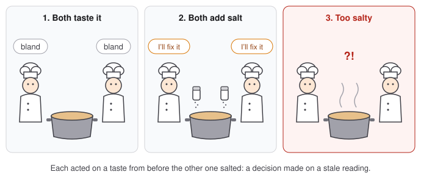

# The Render Loop and Stale State



<div class="page-break"></div>

## React redraws the screen by calling your component again

Your component is a function that returns what the screen should look like. React calls it, draws what it returns, and calls it again whenever a setter says something changed:


- **The first render.** When the page opens, React calls `ToDoList` once. `useState([])` returns its starting value, `[]`, and that is what gets drawn.
- **Then nothing happens** until something does: a click, a key, an answer from the server, a timer. Each of those runs one of your handlers.
- **Only a setter starts the next render.** `setTodos(newList)` tells React the state changed, and asks for a new render.
- **The next render** calls `ToDoList` again. This time `useState` returns the new list, and React changes only the parts of the screen that differ.

Every turn of the loop is one call of your function. Between two events that call no setter, the screen, and every handler on it, stays the same render.

## Deleting two to-dos quickly brings the first one back

Here is `handleDelete` from todo-26's `ToDoList`, as it is now:

```jsx
async function handleDelete(idToDelete) {
  await deleteTodo(idToDelete);
  setTodos(todos.filter((each) => each.id !== idToDelete));
}
```

Delete to-do A, then to-do B before A's request has come back:


Only the screen is wrong: A **was** deleted on the server, and a reload shows the list as it really is. But the user believes the screen. They delete A again and get an error, because it no longer exists, or they tick it off and wonder why it never saves. Adding two to-dos quickly does the same in reverse: the first one is saved, but vanishes from the screen.

Clicking delete on A starts a request and calls no setter until the answer arrives. Until then the screen is still render 1, and so is the delete button on B, with its handler. The unpredictable part is the network: the two answers can come back in either order.

## Each render sees its own copy of the state

Each of those calls has its own `todos`, and its own `handleDelete`, created during that call:

```jsx
function ToDoList({ list }) {
  const [todos, setTodos] = useState([]);   // this render's copy

  async function handleDelete(idToDelete) { // created in this render,
    await deleteTodo(idToDelete);           // so it keeps this render's todos
    setTodos(todos.filter((each) => each.id !== idToDelete));
  }
  // ...
}
```

Two rules follow from that:

- **A function keeps the variables of the moment it was created.** JavaScript calls this a *closure*. `handleDelete` from render 1 sees render 1's `todos`, however long it waits.
- **`setTodos` does not change `todos`.** It asks React for a new render, in which `todos` has the new value. The old render's variable stays as it was.

B's handler was created in render 1, so it never saw render 2.

There are three ways out, each with a cost.

## Fix 1: an updater function works on the state as it is now

A setter accepts either a new value or a function. A function handed to a setter is an **updater function**: React calls it with the newest state, not the copy your handler kept, and uses what it returns as the new state.


For the double delete:

```jsx
setTodos((current) => current.filter((each) => each.id !== idToDelete));
```

Same for adding: `setTodos((current) => [...current, todo])`. Updaters run in the order their setters were called, each on the result of the one before.

It works because it keeps no list. The value form hands React a finished list, computed from the copy the handler kept. An updater hands React a recipe, "remove B from whatever you have", and React applies it to the list it has stored at that moment:


The problem is older than React: you **read** a value, **waited**, and **wrote** back something computed from what you read, while someone else changed it. The updater moves the read to the moment of writing.

## Fix 2: a pending state blocks the next click until the answer is in

Call a setter *before* the `await`, and React renders right away, with the delete buttons disabled:

```jsx
const [pending, setPending] = useState(false);

async function handleDelete(idToDelete) {
  setPending(true);                     // render now: buttons disabled
  try {
    await deleteTodo(idToDelete);
    setTodos(todos.filter((each) => each.id !== idToDelete));
  } finally {
    setPending(false);                  // also when the delete fails
  }
}

<button disabled={pending} onClick={() => handleDelete(todo.id)}>Delete</button>
```

B cannot be clicked while A is on its way, so no two handlers ever wait at the same time.

But the delete buttons are not the only ones that write `todos` after an `await`. Delete A, then add D while A is still on its way: the add handler kept A, B, C, and its answer writes back A, B, C, D. A is back. So the pending state has to lock every change to the list, adding and ticking off included, and the user waits for each request before doing anything else. That is the cost.

## Fix 3: update the screen first, then ask the server

Swap the two lines. The setter runs at the click, React renders, and A is gone before B can be clicked, so B's handler belongs to render 2 and sees B and C:

```jsx
async function handleDelete(idToDelete) {
  const removed = todos.find((each) => each.id === idToDelete);
  setTodos(todos.filter((each) => each.id !== idToDelete));   // render now
  try {
    await deleteTodo(idToDelete);
  } catch (err) {
    setTodos((current) => [...current, removed]);             // put A back
  }
}
```

This is an **optimistic update**: show the result before the server confirms it. It is why a "like" button anywhere feels instant. The cost is the failure case: if the server says no, the to-do has to come back, and putting back only that one needs an updater function again.

## If time passes between reading the state and setting it, use an updater function

Time passes after an `await`, in a timer, and in a callback from a live query. In a click handler with no `await`, nothing can happen in between, and passing the new value is fine.

## A second race: the answer to an old input arrives after the new one

The double delete needed two handlers waiting at once. This one needs a component that **stays on screen while its input changes**, and loads something each time it does.

A search box is the classic case. Suppose todo-26 gets a search that asks the server for matching to-dos as you type. Typing "mi" and then "l" sends two requests, and nothing makes them come back in order. If the "mi" answer is the slower one, the results under "mil" are for "mi":


React runs an effect's cleanup when its input changes, before it runs the effect again. That is where you mark the old answer as stale, and drop it when it arrives:

```jsx
function TodoSearch() {
  const [query, setQuery] = useState("");
  const [results, setResults] = useState([]);

  useEffect(() => {
    let ignore = false;

    async function search() {
      const found = await searchTodos(query);
      if (!ignore) setResults(found);
    }
    search();

    return () => {
      ignore = true;   // the query changed: this answer is for the old one
    };
  }, [query]);

  // ...
}
```

An updater function would not help here. Nothing is stale in what the handler kept; the answer itself is to a question nobody is asking any more. The flag does not stop the request, which still reaches the server; it only throws the answer away.

## It happens on slow networks, so you find it by reading your code, not by testing it

The double delete needs only one thing: the second click before the first answer. On your laptop, on fast wifi, an answer takes a tenth of a second, and you will never see it. On a phone on a train, an answer takes two seconds, and a user tidying a list taps three deletes in a row. Then it happens, to somebody else, and not while you are testing.

So you cannot find this bug by trying the app. You find it by reading your own code and asking, wherever time passes between reading state and writing it: **what if something else happens in between?**

## Exam Questions

### 1. Two to-dos are deleted quickly, one after the other, and the first one reappears. Explain why, step by step, and fix `handleDelete`.
```jsx
async function handleDelete(idToDelete) {
  await deleteTodo(idToDelete);
  setTodos(todos.filter((each) => each.id !== idToDelete));
}
```

### 2. Why is `setTodos([...todos, item])` fine in a click handler without `await`, but risky right after one?

### 3. When would you use an updater function instead of passing a value to the setter?

### 4. A search box shows the results for "mi" while the box says "mil". What happened, how does the effect's cleanup fix it, and why would an updater function not help?
