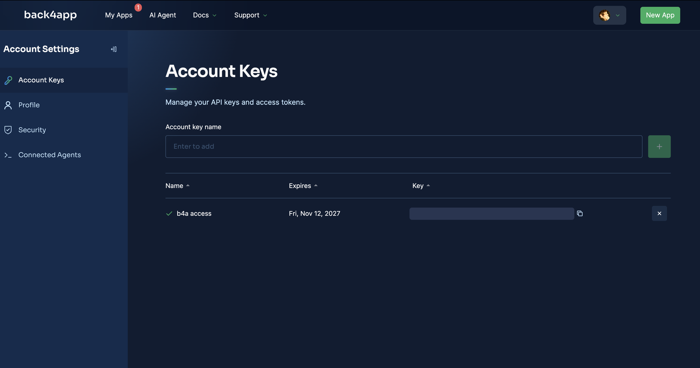
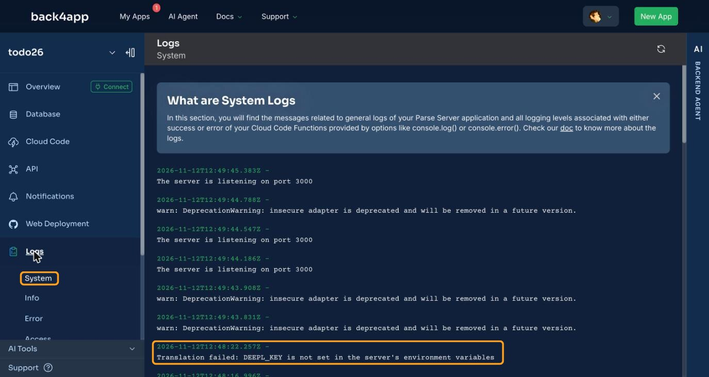
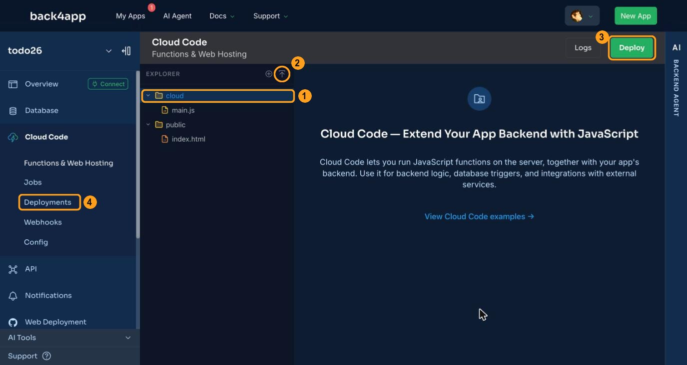

# Deploying Cloud Code from the Command Line

[Running Code Server-Side](../Backend/Running-Code-Server-Side.md) showed triggers and cloud functions. You can paste them into the Back4App dashboard, but then the code lives only there: nobody reviews it in a pull request, and nobody knows which version is running. This note keeps the code in your repository and deploys it from the terminal with Back4App's command-line tool, `b4a`.

## Install `b4a` once per laptop

**macOS and Linux:**

```bash
curl https://raw.githubusercontent.com/back4app/parse-cli/back4app/installer.sh | sudo /bin/bash
```

It asks for your laptop password, because it puts the tool in `/usr/local/bin`.

**Windows:** download `b4a.exe` from the [releases page](https://github.com/back4app/parse-cli/releases) and move it to `C:\Windows\System32`.

Check that it worked:

```bash
b4a version
```

## Give `b4a` an account key, so it can deploy as you

1. On [back4app.com](https://www.back4app.com), open the menu under your picture at the top right, then **Account Settings → Account Keys**.
2. Type a name that says what the key is for, such as `b4a access`, and press **+**. The key appears in the list; copy it with the button next to it.

   

3. In the terminal:

   ```bash
   b4a configure accountkey
   ```

   and paste the key when asked.

The key is stored in your home folder (`~/.back4app/netrc`), not in the project, so it never ends up on GitHub. Anyone with the key can deploy to all your apps: treat it like a password. That includes screenshots: the key is printed in full on that page, so cover it before you share one. If a key leaks, delete it with **×** and make a new one.

The key expires after a year. When `b4a` suddenly cannot log in, make a new key and run `b4a configure accountkey -d` to replace the old one.

## Link a folder in your repository to your Back4App app

Run this from the root of your project, **before** you create a `backend` folder yourself: `b4a new` refuses to use a folder that already exists.

```bash
b4a new
```

It asks four questions:

| it asks | you answer |
|---|---|
| `(n)ew` or `(e)xisting` | `e`: your app already exists |
| `Select an App` | the number of your app in the list |
| `Directory Name` | `backend` |
| `(b)lank`, or ENTER to download | `b` if you have never deployed Cloud Code; ENTER if you have, so you start from what is running |

You get two hidden files, which link this folder to your app:

```
backend/
  .parse.local      your app's ID
  .parse.project    the SDK version, and the email of whoever ran `b4a new`
```

Now create `backend/cloud/main.js` and put your triggers and functions in it.

### `main.js` is where the server starts reading

Back4App loads `cloud/main.js` and nothing else, so the name is fixed. When it grows, split it into files next to it and load them from `main.js`:

```js
// cloud/main.js
require("./todos.js");
require("./lists.js");
```

### Commit the hidden files too, once you have removed your email

`.parse.local` holds your app's ID, which is no secret: every visitor already has it, in your app's JavaScript. `.parse.project` holds the SDK version and **your email**, which does not belong in a repository. Delete the `"email"` line from it; `b4a` works without it.

Then commit both, so a fresh clone can deploy without running `b4a new` again. Vite's `.gitignore` ignores everything ending in `.local`, so make an exception at its end:

```
!backend/.parse.local
```

`backend/` sits next to `src/`: one folder for the code that runs on the server, one for the code that runs on the phone. That matters: Vite bundles only what `src/` imports, so code meant for the server never ships to the phone.

## Deploy, then check that it runs

```bash
cd backend
b4a deploy
```

This uploads `cloud/` and replaces what was running before. In the dashboard, **Cloud Code** now shows your `main.js`.

To load the new code, Back4App restarts your server. For a minute or so after a deploy, the backend may not answer, and the browser may report it as a CORS error. Wait a minute and reload before debugging CORS.

### An npm script remembers the command for you

You already publish the app with `npm run deploy` ([Publishing Your App on GitHub Pages](Publishing-on-GitHub-Pages.md)). Give the backend a script next to it, in the `scripts` of your `package.json`:

```json
"deploy": "npm run build && gh-pages -d dist",
"deploy:backend": "cd backend && b4a deploy"
```

Now `npm run deploy` publishes the part that runs on the phone, and `npm run deploy:backend` the part that runs on the server. The colon is npm's convention for a family of related scripts. A teammate who has never seen `b4a` finds the command where they look for every other one.

Then try what you deployed. For a `beforeSave` trigger, save something it should refuse, from your app or from the dashboard's database browser, and check that the save fails with your message.

### The server's log is in the dashboard, under Logs → System

Your server code has no browser console. What it writes with `console.log` and `console.error` goes to the server's log, which you read in the Back4App dashboard: **Logs → System**, newest line first.



This is where you find out why something did not happen. Above, a to-do was saved without its Danish translation, and the app showed no error, because the trigger catches it on purpose. The log says why: the key was not set yet. A minute later, the server restarts ("The server is listening on port 3000") once the variable is saved.

So write log lines that answer the question you will have later: not `console.error(error)`, but `console.error("Translation failed:", error.message)`.

`b4a logs`, run in the folder you deploy from, prints the latest lines of the same log in the terminal, the lines from your code included, such as `Translation failed: DeepL answered 456`. The first time we tried it, it showed only the start-up lines. If your line is not there yet, look in the dashboard.

Other `b4a` commands for when something goes wrong:

| | |
|---|---|
| `b4a releases` | what was deployed, and when |
| `b4a rollback` | go back to the previous release |
| `b4a help` | every command |

## In a team, deploy from `main` only

Every `npm run deploy:backend` replaces the code on the server, whoever runs it and from whichever branch. Two people deploying from two feature branches overwrite each other, and the app runs whichever came last.

So treat `backend/` like the rest of your code ([Collaboration with Git-Flow](Collaboration-with-Git-Flow.md)): change it on a feature branch, review it in a pull request, and deploy only after it is merged.

On Back4App's free plan this is simpler still: an app has no collaborators (adding one needs a paid plan), so only the account that owns the app can deploy to it. One person in the team owns the backend, and deploys from `main` after a merge.

## Without `b4a`, upload `main.js` by hand

You do not need the command-line tool to deploy. The dashboard does the same job, one click at a time, and installs nothing on your laptop. The code still lives in your repository; you only carry it over by hand.

In your app's dashboard, open **Cloud Code → Functions & Web Hosting**:



1. Select the **`cloud`** folder.
2. Press **Upload** (the arrow above the file tree) and choose `backend/cloud/main.js` from your repository. Click `main.js` in the tree and check that it shows your code.
3. Press **Deploy**. Until you do, the server still runs the old code.
4. **Deployments** lists what was deployed and when; **Logs**, next to Deploy, shows the server's log.

Then try it, as above: save something the trigger should refuse.

Editing `main.js` directly in the dashboard works too, and is fine for trying something out. But code edited there exists only there: copy it back into your repository, or the next upload overwrites it.

## Secrets are set on the server, not written in the code

`main.js` is in your repository, which may be public, so a key to a paid service cannot be written in it. It goes where the code runs: in the server's **environment variables**. In the Back4App dashboard, open **App Settings → Environment Variables** and press **Add variable**. The **Key** is the name your code uses, `DEEPL_KEY`; the **Value** is the secret itself, which the dashboard hides as you type. Then press **Save changes** at the top of the page: **Create** only adds the variable to the list on your screen, and until you save, the server does not have it.

The code reads it from `process.env`:

```js
// backend/cloud/main.js

// Secrets are set on the server, never in the repository. In the Back4App
// dashboard: App Settings → Environment Variables → Add variable,
// with Key DEEPL_KEY and your DeepL key as the Value.
const DEEPL_KEY = process.env.DEEPL_KEY;
```

The comment matters. The repository says **which** secrets exist and where to set them; it never says **what** they are. A teammate who deploys reads it and knows what to ask you for.

Two consequences:

- **A missing variable is `undefined`, not an error.** Check for it where you use it, and fail with a message that says what to set, rather than with a puzzling `Cannot read properties of undefined` somewhere deeper.
- **Saving the variables restarts the server,** like a deploy: give it a minute before you try (see [above](#deploy-then-check-that-it-runs)).

This is the same idea as `.env.local` in your app, with one difference that matters. `VITE_` variables are copied into the bundle at build time and end up on every phone, so they can never hold a secret. The server's variables never leave the server.

## Example: every to-do, translated to Danish

Here is the whole path once, with a real service: when a to-do is saved, the server asks [DeepL](https://www.deepl.com) for the Danish version and stores it next to the original. The app never sees the key, and never calls DeepL itself.

### 1. Get a DeepL key

1. On [deepl.com/pro-api](https://www.deepl.com/pro-api), choose **DeepL API Free** and sign up. The free plan translates 500,000 characters a month.
2. In your DeepL account, open **API Keys** and copy your key. A free key ends in `:fx`.

<!-- TODO: check before class whether DeepL asks for a card at sign-up; sources disagree -->

### 2. Give the key to the server

In the Back4App dashboard: **App Settings → Environment Variables → Add variable**, with **Key** `DEEPL_KEY` and your DeepL key as the **Value**, then **Save changes** (see [above](#secrets-are-set-on-the-server-not-written-in-the-code)).

### 3. Make room for the translation

The translation goes in a new column, `textDanish`. If your `TodoItem` class does not allow clients to add fields ([Field-Level Permissions](../Backend/Field-Level-Permissions.md)), the first save fails with:

```
Permission denied for action addField on class TodoItem.
```

This applies even though it is *our* code that sets the field: a `beforeSave` runs as part of the user's request, with the user's permissions. So add the column yourself, once: **Database → TodoItem → Add a new column**, type **String**, name `textDanish`. The class stays locked, and this one column exists.

### 4. Translate in the trigger

```js
// backend/cloud/main.js
const DEEPL_KEY = process.env.DEEPL_KEY;

Parse.Cloud.beforeSave("TodoItem", async (request) => {
  const todo = request.object;

  // ... the checks on the text, as before ...

  // only when the text is new or changed: ticking a to-do off saves it too
  if (!todo.dirty("text")) return;

  try {
    todo.set("textDanish", await translateToDanish(todo.get("text")));
  } catch (error) {
    // a to-do without its translation is better than a to-do that was not saved
    console.error("Translation failed:", error.message);
  }
});

async function translateToDanish(text) {
  if (!DEEPL_KEY) {
    throw new Error("DEEPL_KEY is not set in the server's environment variables");
  }
  // free keys end in ":fx" and only work on the free host; paid keys on the other
  const host = DEEPL_KEY.endsWith(":fx") ? "api-free.deepl.com" : "api.deepl.com";
  const response = await fetch(`https://${host}/v2/translate`, {
    method: "POST",
    headers: {
      Authorization: `DeepL-Auth-Key ${DEEPL_KEY}`,
      "Content-Type": "application/json",
    },
    body: JSON.stringify({ text: [text], target_lang: "DA" }),
  });
  if (!response.ok) {
    throw new Error(`DeepL answered ${response.status}`);
  }
  const { translations } = await response.json();
  return translations[0].text;
}
```

Three decisions are in there, and each could have gone the other way:

- **`todo.dirty("text")`**: translate only when the text changed. Without it, every tick of a checkbox would call DeepL and spend the quota.
- **`try` / `catch`**: if DeepL is down, the key is wrong or the quota is used up, the to-do is still saved, only without its translation. The opposite choice, refusing the save, would make your app only as reliable as DeepL.
- **The key in a header**, not in the URL: URLs end up in logs.

### 5. Show it in the app

The app only reads the field; it never sets it. Because Parse sends back the fields a `beforeSave` changed, a new to-do arrives already translated:

```js
// src/services/todoService.js, in toTodo
textDanish: item.get("textDanish"), // set by the server, not by the app
```

Then show `textDanish` where you show the text. Remember the to-dos saved before the trigger existed: they have no translation until someone edits them.

**Exercise.** Translate the names of your lists as well. What can you reuse from the to-do trigger, and what do you have to add? (Hint: the answer to the second question is in step 3.)

## ESLint has to be told that `backend/` is server code

ESLint assumes every `.js` file in your project is browser code, because until now it was. `npm run lint` then complains that `Parse` and `process` are not defined. Add a block to `eslint.config.js` that says where this code runs:

```js
{
  files: ["backend/**/*.js"],
  languageOptions: {
    sourceType: "commonjs",
    globals: { ...globals.node, Parse: "readonly" },
  },
},
```

Back4App's server does not need it: it runs `cloud/` the way it always has.
